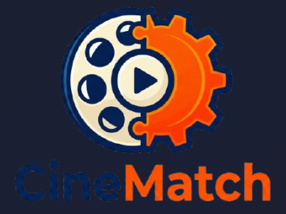
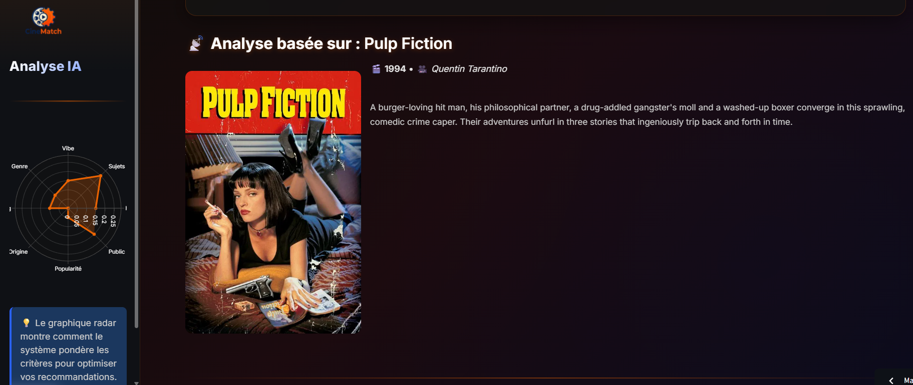
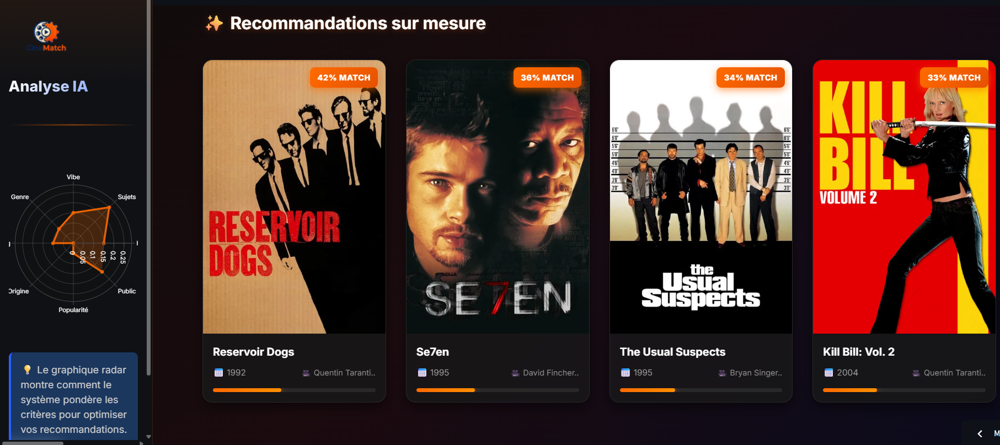
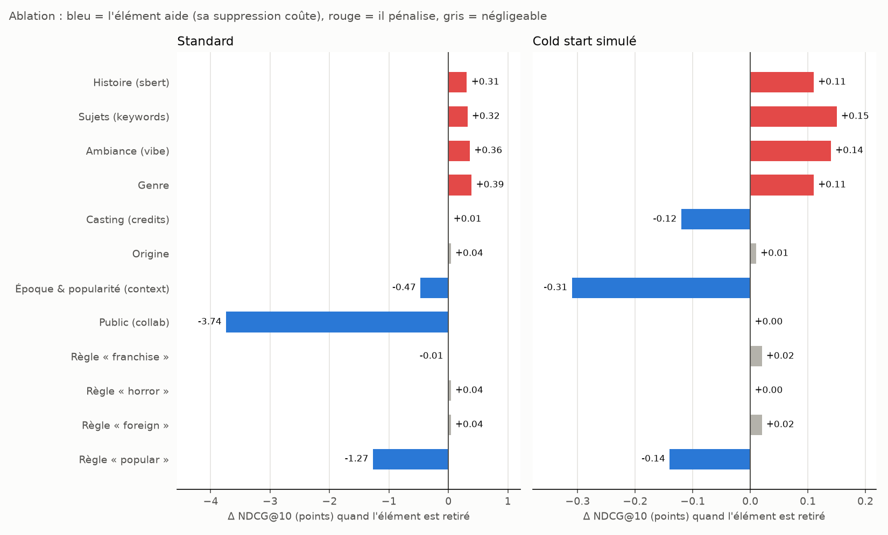

<div align="center">



# CineMatch AI

**A hybrid movie recommender that blends semantic, metadata and collaborative signals, explains every recommendation, and is evaluated offline with an honest protocol.**

[](https://cinematch-reco.streamlit.app/)
[](https://cinematch-reco.streamlit.app/)
[](https://github.com/Victor-MICHELON/CineMatch-recommender/actions/workflows/ci.yml)


[**Live demo**](https://cinematch-reco.streamlit.app/) · [**Case study**](https://victor-michelon.github.io/Victor_MICHELON_Portfolio.github.io/projects/cinematch.html) · [How it works](#-how-it-works) · [Evaluation](#-offline-evaluation) · [Run locally](#-run-locally) · [Design decisions](#-design-decisions) · [Limitations](#%EF%B8%8F-limitations--roadmap)

</div>

<p align="center">
  
  
</p>

---

## Why this project

Keyword filtering ("same genre, same actor") misses what makes two films *feel* alike, while pure collaborative filtering fails on films nobody has rated. CineMatch combines both families of signals and stays **explainable**: every card says which two signals drove it ("same director · similar mood"), and the sidebar radar shows the exact weights used.

Example: *Parasite* (2019) returns *The Host*, *Snowpiercer*, *The Gangster, the Cop, the Devil* and *The Roundup*. Non-English films lean on origin and mood, and Parasite has no MovieLens ratings (cold start), so its audience weight moves to the content signals.

## ✨ Highlights

| | |
| :-- | :-- |
| **8 similarity signals** | Plot (SBERT), keywords, mood, genres, cast & crew, origin, era/popularity, audience (MovieLens) |
| **Adaptive, declarative weights** | Rules (franchise, horror, non-English, very popular) are data in a `WeightConfig`: they can be ablated or tuned |
| **Cold-start aware** | 43 % of the catalogue has no collaborative data; its real audience weight is redistributed to plot / topics / mood |
| **Explainable** | Per-card reasons (top-2 signal contributions `w_k · M_k[i,j]`) + radar of the effective weights |
| **Evaluated** | Leak-free offline protocol on MovieLens, 8 methods compared, bootstrap CIs, ablation, Optuna tuning ([report](reports/eval.md)) |
| **Light & reproducible** | One command rebuilds everything from TMDB + MovieLens; artifacts are **12.2 MB instead of 618 MB**, no pickle |
| **Product features** | "I liked A, B and C" multi-film queries, filters (decade, genre, language, runtime), MMR diversity slider, manual weight sliders, 4/8/12 results with pagination, EN/FR UI, TMDB links and trailers |

---

## 🧠 How it works

```mermaid
flowchart LR
    A[Selected film(s)] --> B[Adaptive weights w_k i<br/>WeightConfig rules]
    B --> C{Collaborative<br/>data for i?}
    C -- no --> D[Redistribute the audience weight<br/>to plot / topics / mood]
    C -- yes --> E
    D --> E[Weighted sum of 8 similarity rows<br/>computed from factors]
    E --> F[Filters, then top-k<br/>optional MMR re-ranking]
    F --> G[Ranked films + per-card reasons + radar]
```

### The eight signals

No `n × n` matrix is stored. Each signal is kept in **factorised form**: row `i` of the similarity is `F @ F[i]` with L2-normalised rows, which is exactly the cosine, computed on demand.

| Signal (UI) | Key | What it captures | Construction | Stored as |
| :-- | :-- | :-- | :-- | :-- |
| Plot | `sbert` | Plot semantics | `all-MiniLM-L6-v2` on title + overview | 6,195 × 384 float16 |
| Topics | `keywords` | Precise topics | TMDB keywords, bag-of-words (`min_df=2`) | sparse `.npz` |
| Mood | `vibe` | Tone / universe | `all-MiniLM-L6-v2` on tagline + genres + keywords | 6,195 × 384 float16 |
| Genre | `genre` | Category | TMDB genres, bag-of-words | sparse `.npz` |
| Cast & crew | `credits` | Artistic fingerprint | Director (×3) + top-4 cast | sparse `.npz` |
| Origin | `origin` | Cultural context | Original language + production countries | sparse `.npz` |
| Era & fame | `context` | Era & notoriety | `exp(-|Δ|/σ)` on popularity (σ=20) and year (σ=10), averaged | computed from the catalogue |
| Audience | `collab` | Audience taste | Item-item cosine on MovieLens ratings | sparse film × user `.npz` |

### Scoring

For a source film *i* and a candidate *j*:

$$S(i,j)=\frac{\sum_{k=1}^{8} w_k(i)\,M_k[i,j]}{\sum_{k=1}^{8} w_k(i)}$$

The weights start from a base profile and are adjusted by rules defined in [`cinematch/config.py`](cinematch/config.py):

| Condition on the source film | Adjustment |
| :-- | :-- |
| Animation, or a digit in the title (sequels) | + topics, + audience |
| Horror | + mood (+0.20), + topics, − cast |
| Non-English original language | + origin (+0.30), − plot |
| > 3,000 TMDB votes | + audience, + era & popularity |
| No collaborative data (cold start) | the **actual** audience weight → split equally over plot / topics / mood |

With several source films, their score vectors are averaged. The **"% MATCH"** on each card is this normalised score: a *relative ranking indicator*, not a probability.

---

## 📊 Offline evaluation

`python -m evaluation.run` produces [`reports/eval.md`](reports/eval.md) and [`reports/eval.json`](reports/eval.json). **Every number below comes from those files.**

**Protocol.** MovieLens `ml-latest-small` restricted to the catalogue. Per-user temporal split (oldest 80 % train, newest 20 % test). Positive = rating ≥ 4. Query = one of the user's 5 most recent liked training films; relevant = the films the user liked in the test period. Already-rated films are excluded from the ranking. **The `collab` signal is rebuilt on the training part only (no leakage).** 20 % of users tune the weights; the other 472 users (2,330 queries) are used once for the final numbers. 95 % CIs come from a 1,000-draw bootstrap over users. *Cold start* replays every query with the source film's collaborative data hidden.

| Method | NDCG@10 standard | NDCG@10 cold start | HitRate@10 cold start | Catalogue coverage |
| :-- | --: | --: | --: | --: |
| Popularity (most-rated films) | **0.087** [0.074–0.101] | **0.087** | **0.354** | 1.4 % |
| Random | 0.002 | 0.002 | 0.014 | 97.5 % |
| SBERT only | 0.010 | 0.010 | 0.051 | 65.9 % |
| Collaborative only | 0.082 [0.074–0.091] | 0.004 | 0.034 | 40.5 % |
| Hybrid, uniform weights | 0.042 | 0.024 | 0.128 | 49.3 % |
| Hybrid, base weights, no rules | 0.044 | 0.016 | 0.083 | 50.0 % |
| Hybrid, handcrafted rules (app default) | 0.057 [0.051–0.064] | 0.017 | 0.091 | 48.2 % |
| **Hybrid, Optuna-tuned weights** | **0.070** [0.063–0.077] | **0.036** [0.032–0.041] | **0.191** | 42.4 % |

**Reading it honestly**

- On films that already have ratings, this task ("which films will this user rate next?") is dominated by popularity: the most-rated-films list wins, and the collaborative signal alone comes close. The hybrid does not beat them there.
- **Cold start is where the hybrid earns its keep:** without ratings, collaborative filtering collapses (HitRate@10 0.034), while the tuned hybrid keeps **0.191 (×5.6)** and an NDCG@10 ten times higher. The popularity list scores well but recommends the same few films to everyone (1.4 % of the catalogue).
- **Rules help:** the rules lift NDCG@10 from 0.044 to 0.057 (+29 %), mostly through the "very popular" rule (ablation: −1.27 points when removed).
- **Tuning helps more:** Optuna (200 TPE trials on validation, objective = mean of standard and cold-start NDCG@10) gives +22 % NDCG@10 on standard queries and ×2.1 on cold start. It shifts weight to era/popularity and audience, so the app still defaults to the handcrafted rules, which stick closer to "films like this one". The tuned profile is one click away in *Advanced mode*.



---

## 🚀 Run locally

```bash
git clone https://github.com/Victor-MICHELON/CineMatch-recommender.git
cd CineMatch-recommender
python -m venv .venv && source .venv/bin/activate
pip install -r requirements.txt -e ".[dev]"

# Optional: movie posters and trailers (a placeholder is shown without a key).
# Free key: https://www.themoviedb.org/settings/api
cp .streamlit/secrets.toml.example .streamlit/secrets.toml   # then edit it
# or: export TMDB_API_KEY=your_key

streamlit run app.py   # downloads the 11 MB artifacts archive on first launch
```

| Task | Command |
| :-- | :-- |
| Rebuild all artifacts from TMDB + MovieLens (needs `TMDB_API_KEY`) | `pip install -e ".[pipeline]" && python -m pipeline.build --zip` |
| Offline evaluation → `reports/eval.md` | `pip install -e ".[eval]" && python -m evaluation.run` |
| Latency benchmark → `reports/bench.json` | `python scripts/bench.py` |
| Tests (integration tests need local artifacts) | `pytest` · `pytest -m "not slow"` |
| Lint & types | `ruff check . && ruff format --check . && mypy` |

**Codespaces / Dev Container:** Python 3.12, the app starts automatically on port 8501.
**Streamlit Community Cloud:** add `TMDB_API_KEY` in *App settings → Secrets*; `requirements.txt` holds the exact tested versions.

---

## 🗂️ Repository layout

```
├── app.py                 Streamlit entry point (< 100 lines)
├── cinematch/             Engine, no Streamlit import (mypy --strict, 99 % test coverage)
│   ├── config.py          Signals, base weights, rules as data (WeightConfig)
│   ├── data.py            Artifacts: Parquet + .npy + .npz, SHA-256 manifest, download
│   ├── engine.py          Scoring, rules, cold start, contributions, MMR, multi-film
│   └── tmdb.py            TMDB client (timeout, retries, parallel cache)
├── ui/                    Components, CSS, EN/FR labels
├── pipeline/              01 fetch TMDB → 02 catalogue → 03 embeddings → 04 metadata → 05 collab
├── evaluation/            Dataset & split, metrics, baselines, run (Optuna, ablation, bootstrap)
├── scripts/               bench.py, compare_legacy.py (non-regression vs the old pickle)
├── reports/               eval.md / eval.json, ablation.png, bench.json, regression.md
├── tests/                 Engine, data, TMDB (mocked), metrics, AppTest UI, integration
└── notebooks/             Design notebook (+ archived experiments)
```

---

## 🔧 Design decisions

* **Factorised signals instead of dense matrices.** The first version shipped eight 6,203² float16 matrices: 618 MB through Git LFS and ~700 MB of RAM, which made the hosted demo slow to start. Storing the factors (embeddings and sparse bag-of-words / rating matrices) gives exactly the same cosines for **12.2 MB on disk and 180 MB of process RAM** ([`reports/regression.md`](reports/regression.md)). A query costs **1.4 ms p50 / 2.2 ms p95** on a laptop ([`reports/bench.json`](reports/bench.json)), still with no PyTorch at serving time.
* **No pickle.** Artifacts are Parquet / `.npy` (`allow_pickle=False`) / `.npz`, checked against a SHA-256 manifest at load time.
* **Engine separated from the UI.** `cinematch/` has no Streamlit import, so it is unit-tested in isolation and reusable from the evaluation code or an API.
* **Rules as data.** `WeightConfig` turns the magic numbers into a dataclass, so the same rules are ablated, tuned by Optuna and applied by the app.
* **Honest evaluation first.** Temporal split, collaborative signal rebuilt on train only, test set used once, CIs, and a cold-start segment, because the interesting claim (the hybrid handles cold start) needs to be measured, not asserted.
* **Homonyms handled by index, not title** ("Title (year)" in the search box).

---

## ⚠️ Limitations & roadmap

- [x] ~~No offline evaluation~~ → leak-free protocol, 8 methods, ablation, CIs ([report](reports/eval.md)).
- [x] ~~Two weighting rules inactive~~ → the catalogue now has `original_language` and `vote_count`; all four rules fire (tested on *Parasite*, *Toy Story*, *The Conjuring*).
- [x] ~~Partial pipeline~~ → `python -m pipeline.build` rebuilds all 8 signals. `collab` matches the old signal exactly (correlation 1.000). `vibe`, whose original code was lost, is rebuilt (correlation 0.50 with the old signal, see [regression report](reports/regression.md)).
- [x] ~~Weight tuning, diversity (MMR), EN/FR toggle~~ → done.
- [ ] **Popularity is a strong baseline** on non-cold films; a learned blender (LightGBM LambdaRank over the 8 similarities) is the natural next step.
- [ ] **Small catalogue** (6,195 films, 1916–2024) and small ratings set (`ml-latest-small`, 610 users). Next: MovieLens 25M and a FAISS index over the embeddings.
- [ ] **TMDB metadata drifts:** the pipeline queries the live API, so a rebuild can change keywords or popularity slightly.

---

## 📚 Data & attribution

* Movie metadata, posters and trailers: [TMDB](https://www.themoviedb.org/). *This product uses the TMDB API but is not endorsed or certified by TMDB.*
* Ratings: [MovieLens `ml-latest-small`](https://grouplens.org/datasets/movielens/), F. M. Harper & J. A. Konstan, *The MovieLens Datasets: History and Context*, ACM TiiS 5(4), 2015. The published artifacts contain L2-normalised MovieLens rating vectors (`fac_collab.npz`), i.e. a transformation of the dataset, distributed under the MovieLens licence terms (non-commercial use, citation required).
* Text embeddings: [Sentence-Transformers](https://www.sbert.net/) `all-MiniLM-L6-v2`, Reimers & Gurevych, EMNLP 2019.

## 📄 License

Code under the [MIT License](LICENSE). Datasets remain subject to their providers' terms.

## 👤 Author

**Victor MICHELON**, Data Science / AI Engineering student

[](https://github.com/Victor-MICHELON/Victor_MICHELON_Portfolio.github.io)
