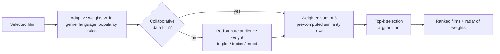

<div align="center">


# CineMatch AI

**A hybrid movie recommender that blends semantic, metadata and collaborative signals — and shows you why it recommends what it does.**

[](https://cinematch-reco.streamlit.app/)


[**Live demo**](https://cinematch-reco.streamlit.app/) · [How it works](#-how-it-works) · [Run locally](#-run-locally) · [Design decisions](#-design-decisions) · [Limitations](#-limitations--roadmap)

</div>

<p align="center">
  
  
</p>

---

## Why this project

Keyword filtering ("same genre, same actor") misses what makes two films *feel* alike, while pure collaborative filtering fails on films nobody has rated. CineMatch combines both families of signals and stays **explainable**: for every query, the sidebar radar chart shows how much each signal contributed to the ranking.

Example — *Pulp Fiction* (1994) returns *Reservoir Dogs*, *Se7en*, *The Usual Suspects* and *Kill Bill: Vol. 2*: same director for two of them, same crime/neo-noir tone for the others.

## ✨ Highlights

| | |
| :-- | :-- |
| **8 similarity signals** | Plot (SBERT), keywords, mood, genres, cast & crew, origin, popularity/era, audience (MovieLens) |
| **Per-film adaptive weights** | The blend changes with the source film: horror leans on mood, popular titles on audience signals, etc. |
| **Cold-start aware** | 43 % of the catalogue has no collaborative data; their audience weight is redistributed to the content signals instead of being silently wasted |
| **Explainable** | Radar chart of the exact weights used for the current recommendation |
| **Fast** | Everything is pre-computed: a query is a weighted sum of 8 matrix rows (~0.2 ms on a laptop, excluding poster downloads) |
| **Tested & portable** | Engine isolated from the UI, unit-tested on synthetic data; optional TMDB key; Dev Container included |

---

## 🧠 How it works



### The eight signals

Each signal is an `n × n` similarity matrix (n = 6,203 films, stored as float16 in `Data/recommender_data3.pkl`, Git LFS).

| Signal (UI) | Key | What it captures | Construction |
| :-- | :-- | :-- | :-- |
| Histoire | `sbert` | Plot semantics | `all-MiniLM-L6-v2` embeddings of title + overview, cosine similarity |
| Sujets | `keywords` | Precise topics | TMDB keywords, bag-of-words, cosine |
| Vibe | `vibe` | Tone / atmosphere | Semantic signal — construction not yet versioned (see [limitations](#-limitations--roadmap)) |
| Genre | `genre` | Category | TMDB genres, bag-of-words, cosine |
| Casting | `credits` | Artistic fingerprint | Director (×3 weight) + top-billed cast |
| Origine | `origin` | Cultural context | Original language + production countries |
| Popularité | `context` | Era & notoriety | `exp(-|Δ|/σ)` on popularity (σ=20) and release year (σ=10), averaged |
| Public | `collab` | Audience taste | MovieLens-based collaborative similarity (construction not yet versioned) |

*Construction details come from the development notebook, which covers six of the eight signals; see [limitations](#-limitations--roadmap).*

### Scoring

For a source film *i* and a candidate *j*:

$$S(i,j)=\frac{\sum_{k=1}^{8} w_k(i)\,M_k[i,j]}{\sum_{k=1}^{8} w_k(i)}$$

The weights $w_k(i)$ start from a base profile and are adjusted by simple, readable rules (see [`recommender.py`](recommender.py)):

| Condition on the source film | Adjustment |
| :-- | :-- |
| Animation, or a digit in the title (sequels) | + topics, + audience |
| Horror | + mood (+0.20), + topics, − cast |
| Non-English original language | + origin (+0.30), − plot |
| > 3,000 votes | + audience, + popularity |
| No collaborative data (cold start) | audience weight → redistributed equally to plot / topics / mood |

The **"% MATCH"** displayed on each card is this normalised score: a *relative ranking indicator*, not a probability.

---

## 🚀 Run locally

```bash
git clone https://github.com/Victor-MICHELON/CineMatch-recommender.git
cd CineMatch-recommender
git lfs pull                       # ~600 MB of similarity matrices

python -m venv .venv && source .venv/bin/activate
pip install -r requirements.txt

# Optional — movie posters (a placeholder is shown without a key).
# Free key: https://www.themoviedb.org/settings/api
cp .streamlit/secrets.toml.example .streamlit/secrets.toml   # then edit it
# or: export TMDB_API_KEY=your_key

streamlit run app.py
```

**Tests** (no data file required): `pip install -r requirements-dev.txt && pytest`

**Codespaces / Dev Container:** open the repository in GitHub Codespaces; the app starts automatically on port 8501.

**Deploy on Streamlit Community Cloud:** add `TMDB_API_KEY` in *App settings → Secrets*.

---

## 🗂️ Repository layout

```
├── app.py                      Streamlit UI: search, radar chart, recommendation cards
├── recommender.py              Scoring engine (pure NumPy/pandas, no Streamlit dependency)
├── tests/                      Unit tests on synthetic data
├── Data/
│   ├── recommender_data3.pkl   DataFrame + 8 similarity matrices (Git LFS)
│   └── recent_movies.csv       Raw TMDB export of ~1,400 recent films
├── hybrid-weighted-…ipynb      Development notebook: 6 of the 8 signals (Kaggle)
├── requirements.txt            Runtime dependencies
└── requirements-dev.txt        Tests + notebook dependencies
```

---

## 🔧 Design decisions

* **Pre-computed dense matrices over on-the-fly encoding.** At 6,203 films the full set is ~600 MB in float16, which buys sub-millisecond queries and a dependency-light runtime (no PyTorch / TensorFlow / SBERT at serving time). The trade-off is quadratic memory: beyond ~20k films, approximate nearest neighbours (FAISS/HNSW) over embeddings would replace it.
* **Engine separated from the UI.** `recommender.py` has no Streamlit import, so the scoring logic is unit-tested in isolation and reusable from a notebook or an API.
* **Rule-based adaptive weights rather than a learned blender.** Transparent and debuggable — and it is what makes the radar chart a faithful explanation rather than a decoration. A learning-to-rank layer is the natural next step once an evaluation set exists.
* **Homonyms handled by index, not title.** 51 titles are shared by several films (e.g. two *Aladdin*); the search box exposes `Title (year)` and the engine works on row positions.
* **Resource caching.** The pickle is loaded once with `st.cache_resource` (no per-rerun copy); poster lookups are cached for 24 h and failures are never cached.
* **No secret in the code.** The TMDB key is read from the environment or Streamlit secrets only.

---

## ⚠️ Limitations & roadmap

Stated plainly, because they matter more than the feature list:

- [ ] **No offline evaluation yet.** Quality is currently judged by inspection. Next: precision@k / recall@k / NDCG on held-out MovieLens ratings, plus an ablation per signal.
- [ ] **Two weighting rules are inactive.** The shipped pickle has no `original_language` / `vote_count` columns, so the non-English and popular-title rules never trigger (visible on non-English films). Rebuilding the data with these columns re-enables them with no code change.
- [ ] **Partial pipeline in this repo.** The notebook covers 6 of the 8 signals on TMDB 5000; the scripts that built `vibe`, `collab`, merged ~1,400 recent films and exported the pickle are not yet versioned here.
- [ ] **Small catalogue** (6,203 films, 1916–2024, median 2008): niche or very recent titles may have weak neighbours.
- [ ] **Roadmap:** weight tuning against an evaluation set · learning-to-rank blender · diversity re-ranking (MMR) · FAISS index for larger catalogues · UI in English/French toggle.

---

## 📚 Data & attribution

* Movie metadata and posters: [TMDB](https://www.themoviedb.org/). *This product uses the TMDB API but is not endorsed or certified by TMDB.*
* Ratings: [MovieLens `ml-latest-small`](https://grouplens.org/datasets/movielens/) — F. M. Harper & J. A. Konstan, *The MovieLens Datasets: History and Context*, ACM TiiS 5(4), 2015.
* Text embeddings: [Sentence-Transformers](https://www.sbert.net/) `all-MiniLM-L6-v2` — Reimers & Gurevych, EMNLP 2019.
* Development datasets as redistributed on Kaggle: [TMDB 5000 Movie Dataset](https://www.kaggle.com/datasets/tmdb/tmdb-movie-metadata).

## 📄 License

Code under the [MIT License](LICENSE). Datasets remain subject to their providers' terms.

## 👤 Author

**Victor MICHELON** — Data Science / AI Engineering student

[](https://github.com/Victor-MICHELON/Victor_MICHELON_Portfolio.github.io)
